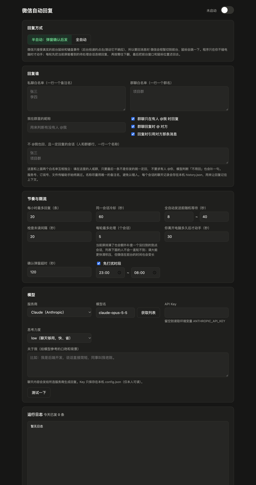
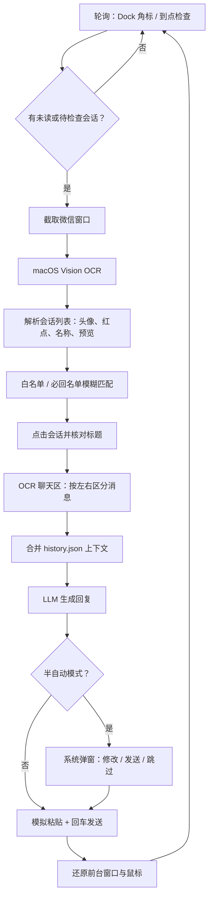

<div align="center">

# 微信自动回复 · Screen OCR Edition

**不注入、不 Hook、不破解协议** —— 用 macOS 原生屏幕识别 + 模拟输入实现的微信 AI 自动回复

*A macOS WeChat auto-reply bot powered by native screen OCR and simulated input. No injection, no hooking, no protocol reverse engineering.*

[](#环境要求)
[](#环境要求)
[](LICENSE)
[](#参与贡献)
[](https://github.com/yiqiquhuxi/wechat-autoreply/stargazers)

[特性](#特性) · [工作原理](#工作原理) · [快速开始](#快速开始) · [配置说明](#配置说明) · [常见问题](#常见问题) · [参与贡献](#参与贡献)

</div>

> [!WARNING]
> 本项目只适合 **在自己的账号上、低频、小范围**使用。它不注入微信进程，但微信服务端的行为风控依然存在，高频群发、营销骚扰仍有封号风险。请先阅读[免责声明](#免责声明)。

---

## 为什么选择屏幕识别

微信没有开放个人号收发消息的官方 API。常见的第三方方案各有代价：

| 方案                   | 做法                             | 风险                             | 维护成本                     |
|------------------------|----------------------------------|----------------------------------|------------------------------|
| 协议逆向 / 网页版协议  | 模拟客户端通信                   | **高**，违反服务条款，容易封号   | 微信一更新就可能整体失效     |
| 注入 / Hook            | 把代码注入微信进程，调用内部函数 | **高**，可能触发安全检测         | 强依赖微信版本               |
| 无障碍 API             | 读取系统 AX 树                   | 中，微信对 AX 暴露的信息有限     | 中                           |
| **屏幕识别（本项目）** | 截屏 + 系统 OCR + 系统级鼠标键盘 | **较低**，不碰进程；仍有行为风控 | 布局自动检测，小改版可自适应 |

本项目的边界很明确： **只做屏幕层的"看"和"点"**。

- 不注入、不 Hook、不修改微信二进制
- 不读取微信数据库、不破解通信协议
- 不依赖任何第三方微信协议服务
- 唯一的外部请求是把你配置的聊天内容发给你选择的 LLM 服务商

代价是它必须让微信短暂到前台，鼠标会跳一下。程序只在 **你离开键盘鼠标一段时间后**才动手，并且一整轮结束后会把前台窗口和鼠标位置还原。

## 特性

- **三套独立名单**：私聊白名单、群聊白名单、「不 @我也一定回」名单，各自匹配，互不影响
- **群聊规则**：默认只在有人 @我 时回复；可自动 @ 对方、可引用对方那条消息
- **免打扰群也能回**：没有红点不代表没有新消息，必回会话每 30 秒、其他白名单会话每 90 秒主动打开确认一次
- **上下文记忆**：每个会话见过的消息攒在本机 `history.json`（默认保留最近 200 条），回复时连着之前的上下文，不是只看屏幕上那几句
- **媒体消息兜底**：图片、语音、表情、文件看不到内容，但能从会话列表的「［图片］」等预览判断对方发了新消息，让模型回一句短话或 emoji
- **速度优先的调度**：每轮先处理当前屏能看到的会话（只扫一次屏），再按需往下翻；第一条回复不会被全列表扫描拖慢
- **公平补查**：当前屏把本轮名额占满时，会额外补查一个「没扫到、但已经到点该看」的会话，列表下面的人不会被前排永远挤掉
- **两种模式**：半自动（系统弹窗确认/修改后发送）和全自动
- **限流与免打扰**：每小时上限、单会话冷却、发送随机延迟、免打扰时段、离开电脑才动手
- **本地面板**：菜单栏开关 + 本地设置页 + 实时日志，配置保存即生效
- **模型可选**：Claude、DeepSeek、通义千问、Kimi、Ollama，以及任何兼容 OpenAI 接口的服务

## 界面预览



## 工作原理



一次完整的处理流程：

1. **感知**：读 Dock 角标；没有未读时，也会按 30 秒 / 90 秒的间隔主动检查白名单会话
2. **定位**：截取微信窗口，自动检测侧栏、会话列表、聊天区的分割位置；在会话列表里按头像切行，识别名称、预览、时间和红点
3. **匹配**：OCR 名称先做精确匹配，再做模糊匹配（表情、生僻字、群人数后缀都能容错）；点开后再核对一次标题，避免点错人
4. **阅读**：对聊天区做 OCR，按消息气泡的左右位置区分「对方」和「我」，只取「我最后一条之后」的新消息；群聊会尽量识别发送者昵称
5. **生成**：把历史上下文和这次的新消息分开交给模型，附带时间戳和长间隔标记；模型判断不需要回复时输出 `[SKIP]`
6. **发送**：半自动模式弹出系统对话框，可修改后再发；全自动模式直接粘贴并回车。引用回复会右键对方最后一条消息 → 点「引用」，失败则退回普通发送
7. **收尾**：整轮结束后还原前台窗口和鼠标位置；你一动键鼠就立刻停止

## 环境要求

| 项目     | 要求                                 |
|----------|--------------------------------------|
| 操作系统 | macOS 12+（开发环境为 macOS 15）     |
| 芯片     | Apple Silicon / Intel 均可           |
| Python   | 3.9+                                 |
| 微信     | macOS 版，已登录，窗口保持可见       |
| 权限     | 辅助功能、屏幕录制                   |
| 模型     | 任一 Claude 或 OpenAI 兼容接口的 API |

> 微信窗口不能最小化，也不能被拖到别的桌面/空间。项目只支持 macOS。

## 快速开始

### 1. 克隆并安装

```bash
git clone https://github.com/yiqiquhuxi/wechat-autoreply.git
cd wechat-autoreply

python3 -m venv .venv
source .venv/bin/activate
pip install -r requirements.txt
```

### 2. 授予系统权限

打开 **系统设置 → 隐私与安全性**，给运行本程序的终端（Terminal / iTerm）开启：

- **辅助功能**（模拟鼠标键盘）
- **屏幕录制**（截屏 OCR）

如果你从 IDE 里启动，就给对应的 IDE 授权。改完权限后需要重启终端/IDE。

### 3. 启动

```bash
python app.py
```

启动后：

- 菜单栏出现 **💬**（暂停时是 **💬⏸**）
- 自动在浏览器打开本地设置页（带随机 token，只监听 `127.0.0.1`）
- 第一次启动默认是 **暂停状态**

### 4. 完成首次配置

在设置页里：

1. 填写私聊白名单、群聊白名单，或「不 @我也一定回」名单
2. 群聊需要填「我在群里的昵称」，用来判断有没有人 @你
3. 选择模型服务商，填模型名和 API Key，点「测试一下」
4. 调整限流和免打扰时段（默认值已经很保守）
5. 点「保存设置」，再通过菜单栏或页面右上角的开关启用

## 配置说明

设置页覆盖了日常需要的全部选项。配置文件保存为项目根目录的 `config.json`（权限 `600`，已被 `.gitignore` 排除）。

### 三套名单的区别

| 名单                   | 作用                   | 触发条件                                                   |
|------------------------|------------------------|------------------------------------------------------------|
| 私聊白名单             | 只回复这些私聊         | 有未读红点，或到点主动检查发现新消息                       |
| 群聊白名单             | 只回复这些群           | 默认需要有人 @我；可关闭此限制                             |
| 不 @我也回、且一定回复 | 人和群都行，优先级最高 | 只要最后一条不是我发的就一定回，模型判断"不用回"也会补一句 |

三套名单 **互相独立**，可以同时命中；服务号、订阅号、文件传输助手等系统会话始终跳过。

### 常用参数

| 参数                               | 默认值               | 说明                                        |
|------------------------------------|----------------------|---------------------------------------------|
| `mode`                             | `confirm`            | `confirm` 半自动弹窗确认；`auto` 全自动发送 |
| `poll_seconds`                     | `20`                 | 两轮之间的检查间隔（最小 5 秒）             |
| `idle_seconds_required`            | `30`                 | 你离开键鼠多久后才开始操作                  |
| `max_chats_per_round`              | `5`                  | 每轮最多处理几个会话（1–20）                |
| `quiet_hours`                      | `["23:00", "08:00"]` | 免打扰时段，支持跨零点                      |
| `confirm_timeout_seconds`          | `120`                | 半自动确认弹窗的超时时间                    |
| `limits.max_replies_per_hour`      | `20`                 | 每小时最多回复条数                          |
| `limits.per_chat_cooldown_seconds` | `60`                 | 同一会话两次回复的最小间隔                  |
| `limits.reply_delay_seconds`       | `[8, 40]`            | 全自动发送前的随机等待区间                  |
| `match_threshold`                  | `0.85`               | 名称模糊匹配阈值，误匹配时可调高            |
| `max_scroll_pages`                 | `10`                 | 会话列表最多往下翻几屏                      |
| `context_messages`                 | `20`                 | 每次交给模型的上下文字数上限                |
| `web_port`                         | `8765`               | 本地设置页端口                              |

### 高级：手动校准布局

界面大改或系统缩放异常时，自动检测的分割线可能不准。可以在 `config.json` 的 `layout_overrides` 里按窗口坐标（pt）覆盖：

```json
{
  "layout_overrides": {
    "sidebar_w": 64,
    "list_w": 260,
    "list_top": 64,
    "title_h": 60,
    "input_top": 520
  }
}
```

先用 `probe.py` 看识别结果，再微调。设置为 `null` 的字段会忽略。

## 模型配置

| 服务商   | 预设       | 默认接口地址                                        | 备注                                               |
|----------|------------|-----------------------------------------------------|----------------------------------------------------|
| Claude   | `claude`   | Anthropic 官方                                      | 走 Anthropic SDK；Key 留空时读 `ANTHROPIC_API_KEY` |
| DeepSeek | `deepseek` | `https://api.deepseek.com`                          | 默认模型 `deepseek-chat`                           |
| 通义千问 | `qwen`     | `https://dashscope.aliyuncs.com/compatible-mode/v1` | OpenAI 兼容模式                                    |
| Kimi     | `kimi`     | `https://api.moonshot.cn/v1`                        | —                                                  |
| Ollama   | `ollama`   | `http://localhost:11434/v1`                         | 本地模型，无需 Key                                 |
| 自定义   | `custom`   | 自己填                                              | 任何兼容 OpenAI 接口的服务                         |

- 模型名不用手填：点「获取列表」直接从服务商拉取当前可用模型
- 「思考力度」只对 Claude 生效：`low` 更快更省，`medium` / `high` 更稳
- 「关于我」会作为人设拼进系统提示词，用来统一口吻
- 点「测试一下」会生成一条示例回复，确认接口通不通

> 聊天内容会发送给你选择的模型服务商。对隐私敏感时请选本地 Ollama。

## 调试与排错

```bash
# 只读探测：看当前微信窗口能识别出什么，不点击、不发送
.venv/bin/python probe.py
.venv/bin/python probe.py --full   # 显示完整 OCR 文本

# 无界面运行
.venv/bin/python run.py            # 按 config.json 运行（需要 enabled=true）
.venv/bin/python run.py -v         # 详细日志

# 演练模式：只滚动列表，不点开会话、不发送；对当前打开的会话生成草稿
.venv/bin/python run.py --dry-run
```

- 截图保存在 `probe_out/`，已被 `.gitignore` 排除
- 运行日志写入 `wxbot.log`（2 MB 轮转，保留 2 份），设置页底部也能实时查看
- 需要看模型实际收到的提示词时，设置环境变量 `WXBOT_DUMP_PROMPT=1`

### 常见启动问题

| 现象               | 处理                                                                      |
|--------------------|---------------------------------------------------------------------------|
| 提示缺少权限       | 系统设置里给终端/IDE 开「辅助功能」和「屏幕录制」，然后**重启**终端或 IDE |
| 提示端口被占用     | 可能已经开着一个实例；或修改 `config.json` 里的 `web_port`                |
| 菜单栏没有 💬      | 确认 `python app.py` 仍在运行；看终端输出和 `wxbot.log`                   |
| 关闭终端后程序退出 | 这是前台进程；需要常驻可配合 `nohup` / `tmux`，但更推荐保持终端窗口       |
| 打开会话标题对不上 | 名称 OCR 误识别，调高 `match_threshold` 或换更独特的备注名                |

## 项目结构

```text
wechat-autoreply/
├── app.py              # 入口：菜单栏图标 + 设置页 + 后台线程
├── run.py              # 无界面入口 / 演练模式
├── probe.py            # 只读探测：窗口、布局、OCR、会话行
├── requirements.txt
├── docs/
│   └── settings.png    # 设置页截图
└── wxbot/
    ├── bot.py          # 调度主循环：扫描、匹配、处理、限流、记忆
    ├── macos.py        # 窗口定位、截图、Vision OCR、鼠标键盘、Dock、空闲检测
    ├── wechat.py       # 布局检测、会话列表解析、聊天区解析、滚动、发送
    ├── llm.py          # 提示词构建 + Claude / OpenAI 兼容调用
    ├── memory.py       # 本机会话记忆 history.json
    ├── config.py       # 默认配置与线程安全读写
    ├── webui.py        # 本地设置页 HTTP 服务
    └── settings.html   # 设置页前端
```

## 安全与隐私

- **不碰微信进程**：所有能力来自 macOS 公开接口（AppKit / Quartz / Vision / Accessibility）
- **本地设置页**：只监听 `127.0.0.1`；地址带每次启动随机生成的 token；校验 `Host` 头，防止你浏览的其他网页偷偷改配置
- **密钥保护**：`config.json` 写入时设为 `600`，且已被 `.gitignore` 排除
- **数据留在本机**：聊天记录只写入 `history.json`；除所选模型服务商外，不上传到任何第三方
- **日志含隐私**：`wxbot.log` 会记录会话名和部分消息内容，分享日志前请先脱敏

## 已知限制

- **只识别文字**：图片、语音、视频、文件看不到内容，只能根据会话预览判断"对方发了媒体消息"
- **OCR 可能认错**：名称做了模糊匹配，点开后还会核对标题；但极端字体/缩放仍可能失败
- **点开即已读**：包括在半自动弹窗里点「跳过」
- **必须保持窗口可见**：微信最小化、在别的桌面，或主窗口被完全遮挡时无法操作
- **仅支持 macOS**：依赖 AppKit、Quartz、Vision，没有 Windows/Linux 版本
- **不处理风控与验证**：遇到微信安全验证、转账、红包等场景不会自动操作
- **不适合重要决策**：模型对约时间、报价、承诺类内容会倾向回复缓冲话，但仍需你自己把关

## 常见问题

<details>
<summary><b>会不会封号？</b></summary>

屏幕识别不注入、不修改微信，规避了注入类方案最直接的风险；但微信服务端仍会做行为风控。请保持低频、只回复真正需要回复的会话，不要群发或营销。 **任何自动化工具都无法保证零风险。**
</details>

<details>
<summary><b>为什么必须让微信到前台？</b></summary>

实测微信不响应后台投递的点击、滚动和按键（`CGEventPostToPid`），只接受真实的前台事件。所以发送时微信必须短暂到前台、鼠标跳一下；程序会在你离开电脑后才动手，并在整轮结束后还原。
</details>

<details>
<summary><b>为什么回复有时候慢？</b></summary>

主要耗时是模型生成，其次是打开会话后的 OCR。调度上已经做了优化：每轮先处理当前屏（只扫一次），第一条回复不做全列表预扫描；需要更快的体验可以换更快的模型，或把 Claude 的「思考力度」设为 `low`。
</details>

<details>
<summary><b>群里为什么没有回复？</b></summary>

默认「群聊只在有人 @我 时回复」。请确认：群在群聊白名单里、已填写「我在群里的昵称」、消息里确实 @了你。如果希望不 @也回，把群加进「不 @我也一定回」名单。
</details>

<details>
<summary><b>免打扰的群没有红点，为什么也会回？</b></summary>

这是刻意设计：红点不是唯一信号。必回会话每 30 秒、其他白名单会话每 90 秒会被主动打开确认一次。如果不想这样，把对应会话移出名单，或调整检查间隔相关设置。
</details>

<details>
<summary><b>支持多开 / 多个微信号吗？</b></summary>

目前不支持多开，也没有针对多账号做测试。一个进程对应一个已登录的微信客户端。
</details>

<details>
<summary><b>能把回复改成我自己的风格吗？</b></summary>

可以。设置页的「关于我」会作为人设拼进系统提示词；也可以在 `wxbot/llm.py` 的 `BASE_RULES` 里调整更细的规则。
</details>

<details>
<summary><b>数据会被上传吗？</b></summary>

除了发给你选择的模型服务商，不会上传到其他地方。设置页、日志、历史记录都在本机。对隐私敏感时选本地 Ollama。
</details>

## 路线图

- [ ] 更稳的引用回复（减少右键菜单识别失败）
- [ ] 语音消息转文字后参与上下文（可选，本地 Whisper）
- [ ] 更好的多显示器 / 窗口位置适配
- [ ] 更多模型预设与提示词模板

欢迎在 Issues 里提需求，或直接提交 PR。

## 参与贡献

欢迎 Issue 和 Pull Request。

1. Fork 本仓库，从 `master` 切出功能分支
2. 提交前先用 `probe.py` 和 `run.py --dry-run` 验证，不要直接拿真实会话做实验
3. 保持项目的安全边界： **不接受注入、Hook、破解协议、读取微信数据库的实现**
4. 代码尽量只依赖标准库和 `requirements.txt` 里的包；新增依赖请在 PR 里说明原因
5. 提交 Issue 时附上 `wxbot.log` 的相关片段，但请先删除昵称、消息内容、API Key 等隐私信息

如果这个项目对你有帮助，点个 ⭐ 就是最好的支持。

## 许可证

本项目基于 [MIT License](LICENSE) 开源。

## 致谢

- [macOS Vision](https://developer.apple.com/documentation/vision) —— 本地 OCR
- [PyObjC](https://pyobjc.readthedocs.io/) —— Python 调用 macOS 原生框架
- [rumps](https://github.com/jaredks/rumps) —— 菜单栏应用
- [Pillow](https://python-pillow.org/) —— 图像处理
- [Anthropic SDK](https://github.com/anthropics/anthropic-sdk-python) / [OpenAI SDK](https://github.com/openai/openai-python) —— 模型调用

## 免责声明

本项目仅供学习、研究和 **在自己账号上**提升回复效率使用。

- 使用本项目即表示你同意自行承担账号被限制、功能不可用等风险
- 请遵守微信的服务条款以及你所在地区的法律法规
- **禁止**将本项目用于群发广告、骚扰、诈骗、冒充他人或其他违法违规用途
- 作者不对因使用本项目造成的任何直接或间接损失负责

---

<div align="center">
<sub>用屏幕识别做一件小工具 · 如果它帮到了你，欢迎 Star ⭐</sub>
</div>
